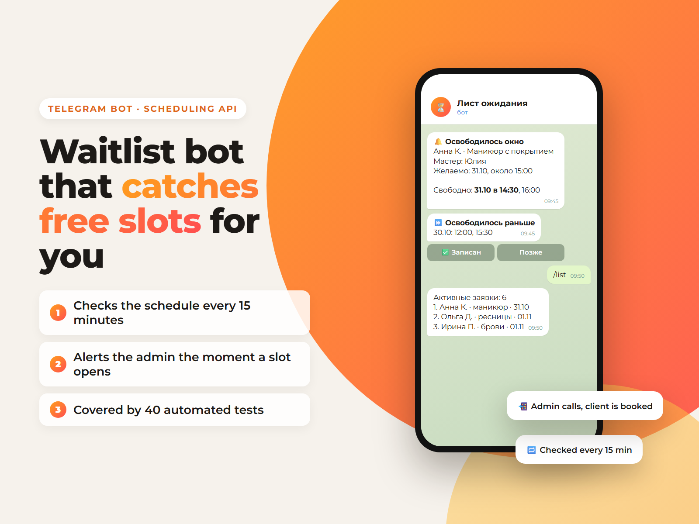

# Waitlist Bot: Telegram + YClients free-slot watcher



An internal Telegram bot for a beauty salon admin. Clients who could not get a slot go on a waitlist with service, master and preferred date. Every 15 minutes the bot checks free slots in the YClients CRM and alerts the admin the moment one opens, including earlier days. In daily use at my own salon.

**Features**
- Step-by-step form: name, phone, service, master (or "any"), date in free form ("tomorrow at 16:00", `25.07.2026`)
- Slot watcher on APScheduler: one API request per (service, master, date) group, earlier-day search, time tolerance
- Duplicate detection by phone + service + date, expired requests, compact list with inline buttons
- Owner / admin access control, FSM state persisted in SQLite (survives restarts)
- Read-only YClients API: the bot never creates bookings, a human does
- 40 automated tests (pytest), Docker and systemd deployment

**Stack:** Python 3.11+, aiogram 3, APScheduler, httpx, aiosqlite, SQLite, pytest, Docker, systemd

## Quick start

```bash
python -m venv .venv && source .venv/bin/activate
pip install -r requirements.txt
cp .env.example .env        # TELEGRAM_BOT_TOKEN, ADMIN_TELEGRAM_ID
python -m pytest -q
python -m bot.main
```

---

**Подробное описание на русском ниже.**

# Telegram-бот «Лист ожидания» (@List_wait_bot)

Внутренний бот администратора салона: хранит заявки клиентов, которым не хватило места, и сам следит за свободными окнами в Yclients. Клиентам бот не пишет и записи в Yclients не создаёт — только подсказывает администратору, что окно появилось.

## Как это работает

1. Клиенту не подошло свободное время — администратор добавляет его в лист ожидания: имя, телефон, **услуга**, **мастер** (или «любой»), дата, время, комментарий.
2. Каждые 15 минут бот спрашивает у Yclients свободные окна по этой услуге и мастеру — на желаемую дату **и на несколько дней перед ней** (`EARLY_SLOT_DAYS`, по умолчанию 7): клиенту обычно выгодно попасть раньше.
3. Как только окно появилось — присылает уведомление всем администраторам бота. Более ранние окна идут в сообщении отдельным блоком «Освободилось раньше» с датой.
4. Администратор звонит клиенту и оформляет запись обычным способом, потом жмёт «Записан».

Повторное уведомление по одной заявке — не чаще раза в 6 часов.

## Команды

- `/start` — главное меню;
- `/add` — добавить клиента (пошаговая анкета);
- `/list` — активные заявки;
- `/today`, `/tomorrow` — заявки на сегодня и завтра;
- `/expired` — заявки, дата которых уже прошла;
- `/check` — проверить окна прямо сейчас;
- `/admins`, `/add_admin`, `/remove_admin` — администраторы (только владелец);
- `/help` — инструкция.

Список приходит одним сообщением, под ним кнопки с номерами заявок. Кнопка открывает карточку с действиями: «Записан», «Удалить», «Проверить окна».

Если такой клиент уже ждёт эту же услугу на эту же дату, бот перед сохранением показывает существующую заявку и спрашивает, добавлять ли вторую. Телефоны сравниваются по цифрам, поэтому `+7 999…` и `8999…` считаются одним клиентом.

Дата понимается в свободной форме: `на завтра`, `завтра в 16:00`, `16:00 завтра`, `25.07.2026`, `2026-07-25`. Если дата и время названы вместе, шаг времени пропускается. Текущий шаг анкеты хранится в SQLite и переживает перезапуск.

Статусы заявок: `waiting`, `notified`, `booked`, `deleted`.

## Доступ

Бот отвечает только администраторам. Если `ADMIN_TELEGRAM_ID` пуст, владельцем становится первый, кто отправил `/start`. Владелец добавляет и удаляет остальных администраторов по числовому Telegram ID; самого владельца удалить нельзя. Новый администратор должен один раз открыть бота и написать `/start`, иначе Telegram не пропустит уведомления. Постороннему бот отвечает отказом и показывает его Telegram ID.

## Локальный запуск

Нужен Python 3.11 или новее.

```powershell
python -m venv .venv
.\.venv\Scripts\Activate.ps1
python -m pip install -r requirements.txt
Copy-Item .env.example .env
```

Заполните `.env` (как минимум `TELEGRAM_BOT_TOKEN` и `ADMIN_TELEGRAM_ID`), затем:

```powershell
python -m bot.main --smoke-check
python -m pytest -q
python -m bot.main
```

На Linux/macOS всё то же самое через `python3 -m venv .venv` и `source .venv/bin/activate`.

## Подключение Yclients

Без Yclients бот работает как обычный лист ожидания: шаги «услуга» и «мастер» пропускаются, `/check` честно сообщает, что проверка выключена.

Для реального мониторинга окон:

```env
YCLIENTS_ENABLED=true
YCLIENTS_BEARER_TOKEN=...
YCLIENTS_USER_TOKEN=...
YCLIENTS_COMPANY_ID=123456
YCLIENTS_CHECK_INTERVAL_MINUTES=15
SLOT_TIME_TOLERANCE_HOURS=3
```

`YCLIENTS_SERVICE_ID` и `YCLIENTS_STAFF_ID` больше не обязательны: услуга и мастер выбираются прямо в заявке. Они остаются запасным вариантом для заявок, где услуга не указана.

Используются только read-only маршруты Yclients API v1:

- `GET /book_services/{company_id}` — список онлайн-услуг (кэш на 6 часов);
- `GET /book_staff/{company_id}?service_id=...` — мастера под услугу;
- `GET /book_times/{company_id}/{staff_id}/{date}?service_ids[]=...` — свободные окна; `staff_id=0` означает «любой мастер», поэтому проверка заявки — это один запрос, а не обход всех мастеров.

Авторизация идёт заголовком `Authorization: Bearer ..., User ...`. Токены не логируются, write-запросов к Yclients в проекте нет.

Заявки с одинаковой услугой, мастером и датой в одном прогоне делят один запрос к API. Окна, время которых уже прошло, отбрасываются; если у заявки указано желаемое время, уведомление приходит только про окна в пределах `SLOT_TIME_TOLERANCE_HOURS` — это правило действует и для более ранних дат.

`EARLY_SLOT_DAYS` задаёт, сколько дней перед желаемой датой тоже проверяются. Одна заявка на «через месяц» стоит `EARLY_SLOT_DAYS + 1` запросов за прогон, поэтому не задирайте значение без нужды: 7 дней — разумный баланс.

## Docker

```bash
cp .env.example .env   # заполнить
docker compose up -d --build
docker compose logs -f waitlist-bot
```

SQLite лежит в volume `waitlist_data` и переживает пересборку контейнера.

## Systemd (постоянная работа на сервере)

```bash
sudo cp deploy/waitlist-bot.service /etc/systemd/system/
sudo systemctl daemon-reload
sudo systemctl enable --now waitlist-bot
journalctl -u waitlist-bot -f
```

Unit рассчитан на каталог `/opt/waitlist-bot` с venv внутри. В `.env` на сервере укажите абсолютный путь к базе: `DATABASE_URL=sqlite:////opt/waitlist-bot/data/waitlist.db`.

Важно: одновременно должен работать **только один** экземпляр бота. Два процесса с одним токеном дают бесконечный `409 Conflict` в логах, и бот перестаёт отвечать.

## Проверки

```bash
python -m bot.main --smoke-check   # конфигурация + SQLite, без сети
python -m pytest -q                # 40 тестов
```

Ручной сценарий:

1. `/start` — появилось меню.
2. `/add` — добавить тестового клиента: услуга ищется по слову («маникюр»), мастер выбирается кнопкой.
3. `/list` — заявка видна в общем списке, кнопка `#N` открывает карточку.
4. `/check` — сводка по окнам без падения.
5. «Записан» → подтверждение → заявка ушла из активного списка.
6. Написать боту со второго аккаунта → отказ в доступе.

## Ограничения

1. Бот только сообщает об окне — записывает клиента человек.
2. Телефон сохраняется как введён, проверяется лишь наличие 7 цифр.
3. «Сегодня» и «завтра» считаются в `TIMEZONE`.
4. Заявка с прошедшей датой не проверяется и не мешает в активном списке, но остаётся в `/expired`, пока администратор её не закроет.
5. В списке показываются первые 20 заявок — салону этого хватает, при росте понадобится пагинация.
